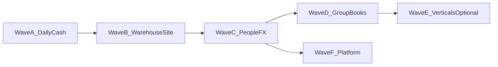

# Full-system deepen waves plan

> **Shipped 2026-11-21:** Waves **A–F** all executed. Migrations `20261121180000` … `20261121202000_wave_f_deepen`. Most phases in `docs/progress.md` are now **Complete (FULL)**; 27/40 remain **Toward FULL** (no Peppol by design).

**Goal:** Ka saar `(LITE)` status-ka phase-yada ee `docs/progress.md` iyadoo la sameynayo **deepen waves** (code + tests + phase doc → `Complete` / `Complete (FULL)`).

**Context:** Phases 1–60 + budget deep waa Complete; 37–60 (iyo qaar 12–16) waa **Complete (LITE)**. Pass-yo hore (2026-11-15 lite deepen, vertical/locale, 2026-11-21 CRM/portal/MRP/API) waxay hore u qaadeen qaar — plan-kani wuxuu ka baxayaa halkaas.

**Business default:** Horn trader + projects/service (AL FURAAT-like). Verticals (hospital, education, NGO, agri) = Wave E oo **optional**.

**Eternal non-goals (ha lagu darin waves):** EMR, IoT printers, MES/PLC, FX dealing desk, DocuSign/eIDAS trademark, Peppol/government portals, untrusted plugins, OTA/LMS, AIA G702, SSO/SAML (ilaa si gaar ah loo maalgeliyo).

---

## Habka mid kasta (exit checklist)

1. Qeex FULL exit (3–7 shaqo) phase file-ka.
2. Schema/migration haddii loo baahdo (`db:new-migration` → `db:deploy`).
3. Service + UI + permissions/feature flags.
4. Tests (`tests/…` ama suite jira).
5. Update `docs/phases/phase-NN-….md` → **Complete (FULL)** + waxa la ship-gareeyay.
6. Update `docs/progress.md` — ka saar `(LITE)`.
7. `pnpm verify` (ama ugu yaraan vitest suite-ka phase-ka).

**Do not:** kaliya beddel label-ka progress.md adigoon code sameyn.

---

## Wave A — Daily cash (sell / stock / jobs / invoices)

**Priority 1.** Operating loop.

| Item | Size | FULL exit (concrete) |
| --- | --- | --- |
| **37 Service jobs** | M | Job = customer + site + tech + window; PART from van; SERVICE bills time; van←warehouse draft transfer; complete = invoice+COGS; cancel restores van; tech day list (no GPS) |
| **38 Contracts** | M | Contract billed vs remaining; milestone % → progress invoice; customer retainage to RETENTION_RECEIVABLE + release; vendor retainage on bill post; change-order amount |
| **41 Retail replenish** | M | Min/max item×store; promo date window on price list; approve→post transfers + pick list |
| **40 + 27 Localization** | M | Pack VAT boxes (SO/KE/ET/DJ) + payroll CSV headers; richer e-invoice JSON download; Setup seed tax+VAT map — **no Peppol** |
| **7 Landed cost** | M | Freight/duty bill allocated onto receipt cost layers |
| **Master-data heal** | S | Heal report CSV; pack-aware tax on items; reorder heal never overwrites clerk value |
| **3 Ship-to** | S | Extra ship-to addresses on customer; docs pick address |
| **20 Portal pay-proof** | S | Portal: bank instructions + upload payment proof (not card gateway) |
| **12 POS till / credit** | M | Cash expected vs counted, session P&L, reprint last; credit hard-block + open exposure |

**Verify:** service-job, contracts, replenish, localization-packs, landed-cost (new), setup-heal, portal, POS session tests.

---

## Wave B — Warehouse, site, quality, projects money — **in progress 2026-11-21** (`20261121190000_wave_b_deepen`)

| Item | Size | FULL exit |
| --- | --- | --- |
| **45 Bins/waves/ASN** | M | Dock calendar on ASN; wave pick→issue→packing CSV; ASN vs PO discrepancy |
| **43 Construction budget** | M | SOV lines (budget / % / this bill / retainage); site store issues → job cost; committed+actual on `/projects/progress` |
| **46 Retainer / utilization** | M | Utilization hours; WIP aging; replenish retainer → unearned invoice |
| **39 CAPA** | S | Owner, due, root cause, effectiveness date; link lot/vendor; quality CSV |
| **25 Job cost rate** | S | Confirm costRate vs charge on job P&L (partially shipped — close remaining UI/report gaps) |
| **53 Encumbrance** | S | Remaining = budget − encumbered − actual; de-encumber on bill/cancel; warn/enforce |
| **44 Mfg capacity** | S | *Only if they assemble:* calendar exceptions + WO planned vs remaining overload |

**Verify:** wms/asn, construction/progress, retainer, capa, project-profitability, commitments.

---

## Wave C — People, FX, credit, risk — **shipped 2026-11-21** (`20261121191000_wave_c_deepen`)

| Item | Size | FULL exit |
| --- | --- | --- |
| **15 HRIS** | M | Hire → contract + wage sync → payroll-eligible; leave/attendance → hours file; pack payroll CSV |
| **16 Collab** | M | Sign attaches to sales/purchase doc; appointments link job/customer + overlap refuse; planning hours → project timesheets |
| **13 FX pay** | M | Pay foreign doc at payment-date rate; residual → FX gain/loss |
| **57 Loans** | M | Disbursement to bank; schedule vs posted; overdue aging; interest accrue without double-count |
| **58 Insurance** | S | Cover dates (vehicle/cargo/site); premium schedule vs bills; claim register (no underwriting) |
| **36 Subscriptions** | M | Dunning list + reminder email; pause/resume/cancel clean unearned; portal upcoming invoices |
| **6 Bank CSV packs** | S | Statement import column packs (date/amount/desc) — not live bank feed |

**Verify:** hris/payroll, sign, appointments, planning, FX payment, loans, insurance, recurring/dunning.

---

## Wave D — Group books (multi-company) — **shipped 2026-11-21** (`20261121200000_wave_d_deepen`)

| Item | Size | FULL exit |
| --- | --- | --- |
| **35 IC elimination** | M | Confirm match → elimination memo journal pair |
| **14 Equity CSV** | S | Event posting = statement accounts; shareholder register + period movement CSV |
| **52 Portfolio KPIs** | S | Group strip: cash/AR/stock/NI at ownership %; YoY |
| **51 Franchise** | S | *If branded branches:* royalty statement + brand P&L roll-up |
| **33 Close approver** | S | Optional second approver on hard-gate close |
| **30/32 Snapshots** | S | Extra metrics: stock value, open jobs, van stock |

**Verify:** consolidation/IC, equity, portfolio, close checklist, analytics snapshots.

---

## Wave E — Adjacent verticals — **shipped 2026-11-21** (`20261121201000_wave_e_deepen`)

| Item | When | FULL exit |
| --- | --- | --- |
| **42 / hospitality** | Kitchen/canteen | Period food-cost %; recipe vs actual variance |
| **47 NGO** | Grants | Fund BS + grant BvA; pledge→receipt→class; donor CSV |
| **50 Agriculture** | Farm | Season = project/class; inputs + harvest lot |
| **56 Marketplace** | Consignment/agents | Seller statement; settle → vendor bill/payment |
| **54 Co-op** | Cooperative | Patronage from purchases → equity event + member CSV |
| **48 Education** | School | Award → fee waiver on term invoice |
| **49 Hospital** | Clinic billing | Claim submitted/paid/denied + remittance to AR (**no EMR**) |

**Verify:** `tests/wave-e-deepen.test.ts` plus hospitality/education/hospital/NGO suites.

---

## Wave F — Platform, proof, adapters — **shipped 2026-11-21** (`20261121202000_wave_f_deepen`)

| Item | Size | FULL exit |
| --- | --- | --- |
| **10 Playwright smoke** | M | One browser path: sell→pay→buy→stock→recon→close |
| **22 Trading API** | M | Caps for invoices list/create, payments, stock on hand, job get/complete (beyond 2026-11-21 four) |
| **59 Sign webhook in** | S | Inbound HMAC → signed/declined on SignRequest; retry log |
| **60 Extensions UI** | S | Org allowlist + capability probe |
| **55 Scale checklist** | S | Periods card: live-year window, archive closed year, pack warning |

**Duplicate timestamp `20261119200000_*`:** both folders remain. They were already applied (later 2026-11-21 Wave A/B/C migrations exist on this tree and the live database is in use). Prisma records the **full folder name** in `_prisma_migrations`; renaming `20261119200000_fiscal_year_start_day` or `20261119200000_project_task_tree_gantt` to `20261119200001_*` would break `prisma migrate deploy` for any database that already has those names. Lexical order is fiscal-year-start-day, then project-task-tree. **Do not rename.** CI for `pnpm verify` remains optional.

---

## Sequencing (default funded order)

1. **A → B → C** haddii saddex wave oo keliya la maalgeliyo.
2. **D** marka labo company la wada xiro.
3. **E** kaliya vertical dhab ah.
4. **F** parallel late A/B ama ka dib C.

---

## Already deepened (ha dib u shaqayn)

- 2026-11-15: lite_deepen 37–40, 51, 56–60; Wave B 41–50 second pass; localization tax seeds; Setup Fix Hub.
- 2026-11-21: portal quote accept/decline; CRM Won→draft estimate; MRP open demand; API +4 capabilities (`phase-depth-crm-portal-mrp-api.md`).
- 2026-11-21 Wave D: IC elim journals, equity CSV, portfolio KPIs, franchise royalty/brand P&L, close second approver, snapshot extras (`20261121200000_wave_d_deepen`).
- Projects waves 1–4 (job costing, Gantt/deps, chatter, portal projects, POS projectId, FX P&L).

Wave A waa inuu ka bilaabmo **waxa weli LITE ah** ee table-yada kore — ha soo celin waxa hore loo ship-gareeyay.

---

## Definition of done (system-wide)

- `docs/progress.md`: dhammaan phases 37–60 ma laha `(LITE)` **ama** verticals E waa `Complete (LITE)` si ula kac ah oo la calaamadeeyay “optional vertical”.
- Mid kasta oo FULL: phase md + tests + `pnpm verify` green for touched suites.
- README cusboonaysiiyay (phase status, db scripts).

---

## Next action when executing

Start **Wave A** in this order: landed cost → 41 replenish → 37 service → 38 contracts → 40/27 packs → heal/ship-to/portal-proof → POS till. One PR (or commit series) per phase exit; update progress after each.
